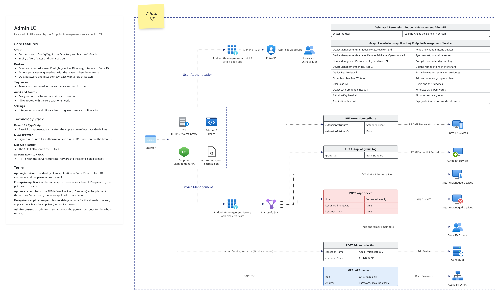
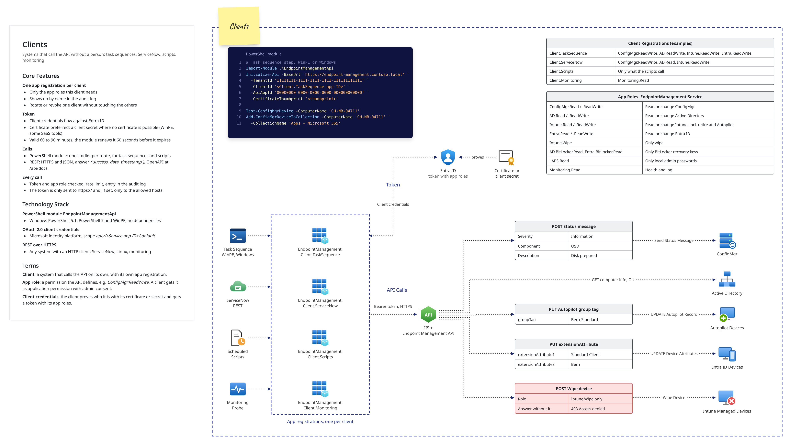

# 01 – Architecture

## Components

The first drawing shows the admin UI: people sign in through `EndpointManagement.AdminUI`, the service calls Microsoft Graph with its own registration and reaches ConfigMgr and Active Directory directly. The second shows client systems, each with its own app registration and app roles. Both use sample values.

| Hop | How |
|---|---|
| Callers → IIS | HTTPS on 443 with the server certificate (its SAN contains the host name clients use) |
| IIS → service | URL Rewrite + ARR to `http://127.0.0.1:5080`, header `X-Forwarded-Proto` as the client came in (`https`; plain HTTP is refused by IIS with *Require SSL*); the service trusts these headers only from `127.0.0.1` / `::1` |
| Service | Node.js as Windows service (WinSW), runs as gMSA; validates Entra ID tokens (JWKS); 91 API routes, admin API and the admin UI files |
| → ConfigMgr | AdminService `https://<provider>/AdminService`, through the Windows helper |
| → Active Directory | `ldaps://<dc>:636`, simple bind with a service account |
| → Microsoft Graph | Intune and Entra ID, certificate or client secret |
| Windows helper | `powershell.exe` over stdin/stdout: AdminService requests, discovery records, full policy reset (WMI), Windows Event Log, encrypted LAPS passwords, DPAPI for `secrets.json` |

- **IIS** terminates TLS with the existing certificate and forwards to the service on localhost. It can be a site of its own or an application below an existing site (default `/EndpointManagementAPI`).
- **The service** listens only on `127.0.0.1`. It is a plain Node.js process wrapped as Windows service by WinSW (restart on failure, delayed auto start, log rolling).
- **The admin UI** is a static React app served by the service itself. It signs people in with Entra ID and calls the same API with their token.
- **Saved sequences** (`POST /api/sequences/{name}/run`) run inside the service as one internal request per step with the caller's token, so every step passes the same role check, rate limit and audit as a direct call.

## Request flow

1. `onRequest` – reject plain HTTP (`server.requireHttps`).
2. Route handler – validate the Entra token, check the app role, check that the area is not switched off, validate route parameters and body, call the service.
3. Envelope – `{ success, data, timestamp }` or `{ success: false, error, timestamp }`.
4. `onSend` – `Cache-Control: no-store` on every `/api/` answer.
5. `onResponse` – audit entry (caller, route, status, duration) to `audit.log` and the in-memory buffer for the UI.

A request that waits for ConfigMgr (collection refresh) stops waiting when the caller disconnects.

## Code structure

| Layer | Folder | Responsibility |
|---|---|---|
| Connectors | `src/connectors` | transport and authentication to one system; no business rules |
| Services | `src/services` | the logic per system (look up resource ID, check membership, …) |
| Routes | `src/routes` | `contract.ts` lists all 91 routes with their roles; `handlers.ts` maps `<Area>.<action>` to a service call |
| Security | `src/security` | token validation, roles |
| Sequences | `src/sequences` | runs saved sequences; `actionCatalogue.ts` is generated from the admin UI's action list |
| Runtime | `src/runtime` | health checks, audit buffer, runtime settings, saved sequences, event log, expiry warnings, log as XML |
| Remote | `src/remote` | the ports of ConfigMgr and Active Directory and the layer that can run them behind a boundary ([below](#configmgr-and-active-directory-behind-ports)) |

A new route means: add it to `contract/routes.json` and `contract.ts`, add the service method (and, for ConfigMgr or AD, its name in `src/remote/ports.ts`), add one line in `handlers.ts`, add a test. Roles, validation, envelope and audit come with the route.

### ConfigMgr and Active Directory behind ports

Routes and sequences reach ConfigMgr and Active Directory only through two ports, `ConfigMgrPort` and `ActiveDirectoryPort` (`src/remote/ports.ts`): a fixed list of async methods. They cannot tell whether a call runs in this process or behind the remote layer, which is chosen with `onPrem.mode` ([06](06-configuration.md)):

| `onPrem.mode` | What happens |
|---|---|
| `local` (default) | the services run in this process, as before |
| `loopback` | the services still run in this process, but every call is turned into a request, sent as JSON text to a dispatcher and answered the same way. This checks the remote layer against the real systems |

Rules of the remote layer:

- The dispatcher runs only the methods listed in `ports.ts`. A public async method that is missing from the list does not compile.
- Arguments and answers are plain JSON. A `Date`, `Map`, `Set` or `Buffer` is refused instead of silently changing.
- Errors come back as the same class (`ApiError`, `AdminServiceError`, `LdapError`, `GraphError`), so every route answers with the same status and text. The LDAP diagnostic stays in the log of the side that ran the call.
- One attempt per call. After `onPrem.callTimeoutSeconds` the caller gets 504 with the note that a change may still have been made; nothing is sent again.
- Arguments and answers are never logged (LAPS passwords, BitLocker keys).

`npm test` runs the whole suite twice: in-process, then with ConfigMgr and AD behind the remote layer (`vitest.remote.config.ts`).

## Design decisions

| Decision | Why |
|---|---|
| Node.js + TypeScript | one language for backend, UI and tooling. ConfigMgr is reached through the AdminService, the REST API ConfigMgr itself provides (see 04). |
| Fastify | fast, small, schema-aware, first-class TypeScript and OpenAPI support |
| IIS in front | existing certificates, bindings and firewall rules; TLS stays in IIS |
| Windows service via WinSW | restarts on failure, runs as gMSA, no extra runtime (PM2 etc.) needed |
| Route contract in `contract/routes.json` | the contract test fails if a route goes missing or its roles change |
| Entra ID app roles for every caller | one permission model for machines (application permissions) and people (group assignments) – see 03 |
| Plain JSON over HTTPS | TLS protects the body; no shared keys on clients |
| Runtime settings in `runtime.json` | switch an integration off or change the log level without a restart, from the UI |
| Windows helper process for ConfigMgr | the AdminService needs Windows sign-in with channel binding; DDR and full policy reset need Windows APIs |
