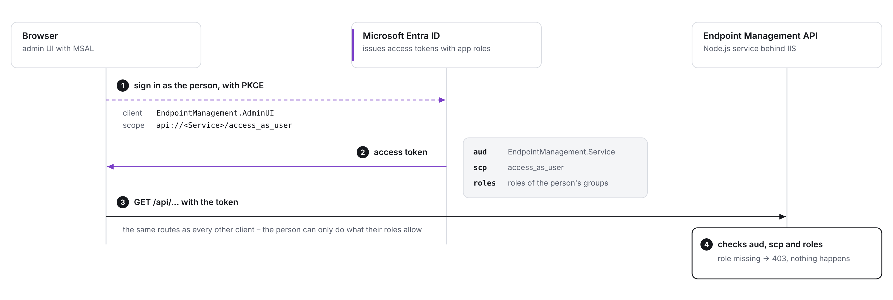

# 03 – Entra ID setup

All access to the API goes through **Entra ID app roles** on one app registration, `EndpointManagement.Service`. Machine clients get roles as application permissions, people get them through Entra groups. There are no API keys and no local user lists.

## Permission overview

### App registrations

| App registration | Required | Type | Credential | Purpose |
|---|---|---|---|---|
| `EndpointManagement.Service` | **always** | web API | certificate or secret (only for its own Graph calls) | the API: defines the app roles, is the token audience, calls Microsoft Graph |
| `EndpointManagement.AdminUI` | **when the admin UI is used** | single-page application | none (PKCE) | signs people in to the admin UI |
| `EndpointManagement.Client.<Name>` | **one per client system** | confidential client | certificate (preferred) or secret | a machine caller: task sequences, ServiceNow, scripts, … |

So the minimum is **two** registrations (Service + AdminUI) plus **one per client system**, for example:

| Client registration | Used by | Typical roles |
|---|---|---|
| `EndpointManagement.Client.TaskSequence` | OSD task sequences in WinPE and Windows (PowerShell module) | ConfigMgr.ReadWrite, AD.ReadWrite, Intune.ReadWrite, Entra.ReadWrite |
| `EndpointManagement.Client.ServiceNow` | ITSM workflows (REST) | ConfigMgr.ReadWrite, AD.Read, Intune.ReadWrite |
| `EndpointManagement.Client.Monitoring` | monitoring probe on `/api/monitoring/health` | Monitoring.Read |
| `EndpointManagement.Client.Scripts` | scheduled scripts of the client team | only what the scripts call |

One registration per client keeps rights small, shows the client by name in the audit log, and lets you rotate or revoke one client without touching the others. How a client calls the API – PowerShell module or plain REST – is in [10 Clients](10-clients.md).

### App roles (defined on EndpointManagement.Service)

| Role | Reading (GET) | Changes (POST, PUT, DELETE) | Allowed for |
|---|---|---|---|
| `ConfigMgr.Read` / `ConfigMgr.ReadWrite` | `/api/configmgr/…` with either role | ReadWrite | clients and people |
| `AD.Read` / `AD.ReadWrite` | `/api/ad/…` with either role, except BitLocker recovery keys and LAPS | ReadWrite | clients and people |
| `AD.BitLocker.Read` | **only** the BitLocker recovery key route of AD | – | clients and people |
| `Intune.Read` / `Intune.ReadWrite` | `/api/intune/…` with either role | ReadWrite – includes retire, delete and Autopilot, not wipe | clients and people |
| `Intune.Wipe` | – | **only** wipe | clients and people |
| `Entra.Read` / `Entra.ReadWrite` | `/api/entra/…` with either role, except BitLocker recovery keys and LAPS | ReadWrite | clients and people |
| `Entra.BitLocker.Read` | **only** the BitLocker recovery key route of Entra ID | – | clients and people |
| `LAPS.Read` | **only** the two LAPS password routes (AD and Entra ID) | – | clients and people |
| `Monitoring.Read` | health, log; admin UI Status, Audit, Routes, Settings (view) | – | clients and people |
| `Admin.Manage` | admin UI pages like Monitoring.Read | admin UI Settings | people only |

Rule for every route: **GET needs Read or ReadWrite of its area, every other method needs ReadWrite.** Four exceptions have a role of their own, so you hand them out separately: wiping a device (`Intune.Wipe`), reading a BitLocker recovery key from AD (`AD.BitLocker.Read`) or Entra ID (`Entra.BitLocker.Read`), and reading a local administrator password (`LAPS.Read`). Neither Read nor ReadWrite includes them. The roles per route are in [09](09-api-reference.md) and in the admin UI under *Routes*.

### Who grants what where

| Caller | Roles are granted in | Part |
|---|---|---|
| a client system | *App registrations → EndpointManagement.Client.<Name> → API permissions → Application permissions* + admin consent | E |
| a person (admin UI) | *Enterprise applications → EndpointManagement.Service → Users and groups* → an **Entra group** + role | B |

### Checklist

1. Part A – `EndpointManagement.Service`: app roles, Application ID URI, scope `access_as_user`, Graph permissions.
2. Part B – groups `G_EMAPI_*`, assignment required, roles assigned to the groups.
3. Part C – `EndpointManagement.AdminUI`: SPA redirect URI, delegated permission, admin consent; authorize it in A2.
4. Part D – `appsettings.json` (`apiAppId`, `adminUiClientId`), restart, sign in.
5. Part E – one client registration per client system, with only its roles.

The admin UI is part of every installation (`adminUi.staticDir` is set by the installer). **Whenever the UI is used, parts A–D are required.** Without `entra.adminUiClientId` the UI shows "Sign-in is not set up yet" and the service log warns at start-up. Clients (part E) work without the UI.

How it fits together:

<picture>
  <source media="(prefers-color-scheme: dark)" srcset="images/entra-admin-ui-sign-in-dark.png">
  
</picture>

The UI calls the same API routes as every other client, **with the signed-in person's token**. A person can therefore only see and do what their roles allow – actions they lack the role for stay in the menu, greyed out with the role they need, and the API refuses them anyway (403).

---

## A. EndpointManagement.Service – the API registration

*Entra admin center → App registrations → EndpointManagement.Service*

Optional logo: *Branding & properties → Upload new logo*, one of the PNGs in [entra-logos](images/entra-logos): the admin UI logo, only the background colour differs per registration.

### A1. App roles

*App roles → Create app role* – one entry per row. **Allowed member types = Both (Users/Groups + Applications)**, so clients and people can get them; `Admin.Manage` for people only.

| Display name | Value | Description | Allowed member types | Used for |
|---|---|---|---|---|
| ConfigMgr Read | `ConfigMgr.Read` | Read devices, collections and primary users in ConfigMgr | Both | GET on `/api/configmgr` |
| ConfigMgr Read Write | `ConfigMgr.ReadWrite` | Read and change ConfigMgr: client actions, collections, OS deployment, delete | Both | all of `/api/configmgr` |
| Intune Read | `Intune.Read` | Read managed devices, compliance and Autopilot records in Intune | Both | GET on `/api/intune` |
| Intune Read Write | `Intune.ReadWrite` | Read and change Intune devices: sync, restart, rename, remediations, retire, delete (no wipe) | Both | all of `/api/intune` except wipe |
| Entra Read | `Entra.Read` | Read devices, groups and users in Entra ID (no BitLocker keys, no LAPS) | Both | GET on `/api/entra` (not BitLocker keys, not LAPS) |
| Entra Read Write | `Entra.ReadWrite` | Read and change Entra ID: enable/disable devices, extension attributes, group membership | Both | all of `/api/entra` except BitLocker keys and LAPS |
| AD Read | `AD.Read` | Read computer accounts, groups and users in Active Directory (no BitLocker keys, no LAPS) | Both | GET on `/api/ad` (not BitLocker keys, not LAPS) |
| AD Read Write | `AD.ReadWrite` | Read and change Active Directory: create, move, enable/disable, delete computers, groups | Both | all of `/api/ad` except BitLocker keys and LAPS |
| AD BitLocker Read | `AD.BitLocker.Read` | Show BitLocker recovery keys stored in Active Directory | Both | `GET /api/ad/devices/{computerName}/bitlocker/keys/{keyId}` only |
| Entra BitLocker Read | `Entra.BitLocker.Read` | Show BitLocker recovery keys stored in Entra ID | Both | `GET /api/entra/devices/{computerName}/bitlocker/keys/{keyId}` only |
| LAPS Read | `LAPS.Read` | Show local admin passwords (Windows LAPS) from AD and Entra ID | Both | `GET /api/ad/computers/{computerName}/laps` and `GET /api/entra/devices/{computerName}/laps` only |
| Intune Wipe | `Intune.Wipe` | Wipe Intune devices (factory reset), for lost or stolen devices | Both | `POST /api/intune/devices/{computerName}/wipe` only |
| Monitoring Read | `Monitoring.Read` | Status, health, audit log and routes of the API | Both | health, log, admin UI status, audit log, routes |
| Admin Manage | `Admin.Manage` | Change settings of the API in the admin UI (people only) | **Users/Groups** | change settings in the admin UI (integrations on/off, encryption, log level, notice) |

The rule: **GET needs Read or ReadWrite, everything else ReadWrite.** `Admin.Manage` is not needed for device actions; it only unlocks the Settings page.

> Wipe, BitLocker recovery keys and LAPS passwords are deliberately not part of ReadWrite. A token without `Intune.Wipe` gets 403 on wipe, one without `AD.BitLocker.Read` or `Entra.BitLocker.Read` gets 403 on the recovery key, one without `LAPS.Read` gets 403 on the password – even with ReadWrite of the area. All of them are written to the Windows Event Log as critical actions (3100) and count against the hourly critical limit.

### A2. Expose an API

*Expose an API*

1. **Application ID URI** – if empty, select *Add* and accept `api://<client ID of the Service app>`, e.g. `api://00000000-0000-0000-0000-000000000000`.
2. **Add a scope**:

   | Field | Value |
   |---|---|
   | Scope name | `access_as_user` |
   | Who can consent? | **Admins and users** |
   | Admin consent display name | Use the Endpoint Management admin UI |
   | Admin consent description | Lets the admin UI call the Endpoint Management API as the signed-in person. |
   | User consent display name | Use the Endpoint Management admin UI |
   | User consent description | Lets the admin UI call the Endpoint Management API with your permissions. |
   | State | Enabled |

   The full scope is `api://<Service client ID>/access_as_user`. The service requests exactly this scope unless `entra.adminUiScope` says otherwise.
3. **Authorized client applications** – *Add a client application*: the client ID of `EndpointManagement.AdminUI` (part C), tick the scope `access_as_user`. Nobody sees a consent prompt afterwards. (Do this after part C, once the AdminUI app exists.)

The scope only says "this person uses the UI". **What** they may do comes from the app roles in their token, not from the scope.

### A3. Token version and Graph

- **Manifest** – `"requestedAccessTokenVersion": 2` is recommended. The service accepts v1.0 and v2.0 access tokens either way.
- **Graph permissions** – *API permissions → Add a permission → Microsoft Graph → Application permissions*, then *Grant admin consent*:

  | Permission | Area | For |
  |---|---|---|
  | `DeviceManagementManagedDevices.ReadWrite.All` | Intune | device info, compliance, co-management, category, primary user, delete, detected apps |
  | `DeviceManagementManagedDevices.PrivilegedOperations.All` | Intune | sync, restart, lock, wipe, retire, rename, Defender scan, LAPS rotation, remediation on demand |
  | `DeviceManagementServiceConfig.ReadWrite.All` | Intune | Windows Autopilot: read the record, set the group tag, delete it |
  | `DeviceManagementScripts.Read.All` or `DeviceManagementConfiguration.Read.All` | Intune | list the remediations of the tenant (picker in the admin UI); one of the two is enough |
  | `Device.ReadWrite.All` | Entra ID | device lookup and info, extension attributes, enable/disable. `Device.Read.All` is enough if nobody changes devices |
  | `GroupMember.ReadWrite.All` | Entra ID | find groups by name, list members, add and remove devices and users |
  | `User.Read.All` | Entra ID, Intune | users by sAMAccountName, user info, devices of a user, primary user |
  | `DeviceLocalCredential.Read.All` | Entra ID | Windows LAPS: whether a password is backed up, and the password itself (`LAPS.Read`) |
  | `BitlockerKey.Read.All` | Entra ID | BitLocker recovery keys (`Entra.BitLocker.Read`) |
  | `Application.Read.All` | admin UI | expiry warnings for client secrets and certificates of this and the client app registrations ([07](07-operations.md#expiry-warnings)); optional, without it the admin UI shows "permission missing" for that source |

  **Not needed** – the API never uses them, so remove them if they are granted: `DeviceManagementApps.ReadWrite.All`, `DeviceManagementConfiguration.ReadWrite.All`, `DeviceManagementScripts.ReadWrite.All`, `Group.ReadWrite.All` (`GroupMember.ReadWrite.All` is enough), `User.ReadWrite.All` and `User.ManageIdentities.All` (`User.Read.All` is enough), `Organization.Read.All` (the health check also works without it). The delegated `User.Read` that Entra adds to every registration can stay.


  `GroupMember.ReadWrite.All` reaches every group of the tenant that is not role-assignable. The service limits it: the group routes never change groups in `entra.protectedGroups` (default `G_EMAPI_*`) and, when `entra.managedGroups` is set, only change those ([06](06-configuration.md#scope-what-a-readwrite-role-may-reach)). Set `managedGroups` in production.

  Leave out what an area does not use (e.g. no Intune: the first four). The service uses this registration's identity for Graph calls (`entra.graphClientId`). Prefer a **certificate** over the client secret: *Certificates & secrets → Certificates → Upload*, and store the PEM (certificate + private key) at `entra.graphCertificatePath`, readable by the service account only.

---

## B. Enterprise application of EndpointManagement.Service – who gets which role

*Entra admin center → Enterprise applications → EndpointManagement.Service*

### B1. Require assignment

*Properties → Assignment required?* **Yes** → *Save*. Only people (through their groups) that are assigned can get a token for the API. Everyone else gets "AADSTS50105: … not assigned to a role" at sign-in.

### B2. Create the groups

*Entra admin center → Groups → New group* – type **Security**, membership **Assigned** (or dynamic, if that suits you). Proposed set:

| Group | Purpose | Roles (part B3) |
|---|---|---|
| `G_EMAPI_Viewers` | service desk, read only | Monitoring.Read, ConfigMgr.Read, AD.Read, Intune.Read, Entra.Read |
| `G_EMAPI_Operators` | client engineering, device actions | Monitoring.Read, ConfigMgr.ReadWrite, AD.ReadWrite, Intune.ReadWrite, Entra.ReadWrite |
| `G_EMAPI_Admins` | owners of the service | all roles including Admin.Manage |
| `G_EMAPI_BitLocker` | service desk, recovery keys | AD.BitLocker.Read, Entra.BitLocker.Read |
| `G_EMAPI_LAPS` | service desk, local admin passwords | LAPS.Read |
| `G_EMAPI_Intune_Wipe` | few people, lost or stolen devices | Intune.Wipe |

**Base group plus add-ons:** every person is in exactly **one base group** (`G_EMAPI_Viewers`, `G_EMAPI_Operators` or `G_EMAPI_Admins`) and, if needed, in add-on groups (`G_EMAPI_BitLocker`, `G_EMAPI_LAPS`, `G_EMAPI_Intune_Wipe`). An add-on alone is of no use in the admin UI: without the read roles of a base group the device page cannot find the device, so there is nothing to wipe or read a key for. `G_EMAPI_Admins` already has all roles and needs no add-on.

| Person | Groups |
|---|---|
| service desk | `G_EMAPI_Viewers` + `G_EMAPI_BitLocker` + `G_EMAPI_LAPS` |
| client engineer | `G_EMAPI_Operators` (+ `G_EMAPI_LAPS` if needed) |
| lost or stolen devices | `G_EMAPI_Viewers` or `G_EMAPI_Operators` + `G_EMAPI_Intune_Wipe` |
| owner of the service | `G_EMAPI_Admins` |

Adapt names and cuts to your role model. Wipe, recovery keys and LAPS passwords have their own groups on purpose: membership there is the list of who may do it. Client systems are different: they call the routes directly, so a client with only `Intune.Wipe` can wipe a device by name (part E).

Groups synchronised from on-premises AD (Entra Connect / Cloud Sync) work the same way.

**Protect these groups:** everyone with `Entra.ReadWrite` could otherwise add themselves to `G_EMAPI_Admins` through the API, since the service may change group members. The service refuses every group in `entra.protectedGroups` (default `G_EMAPI_*`) with 403. If you name the groups differently, put your names into `entra.protectedGroups` (and into `activeDirectory.protectedGroups` when they come from AD). Role-assignable groups (*Microsoft Entra roles can be assigned to the group* = Yes) cannot be changed with `GroupMember.ReadWrite.All` at all.

### B3. Assign the roles to the groups

*Users and groups → Add user/group*

1. *Users and groups* → pick **one** group, e.g. `G_EMAPI_Operators`.
2. *Select a role* → pick **one** role, e.g. `ConfigMgr Read Write`.
3. *Assign*.
4. Repeat for every role of the group. One assignment = one group + one role, so `G_EMAPI_Operators` appears five times in the list.

Notes:

- **Licence:** assigning *groups* to an enterprise application needs **Microsoft Entra ID P1 or P2**. Without it, only single users can be assigned (same steps, choose users instead of a group).
- **No nesting:** only *direct* members of an assigned group get the roles. A group inside `G_EMAPI_Operators` does not pass them on. Put people (or a dynamic rule) directly into the assigned group.
- **People, not machines:** machine clients do not get roles here; see B4.
- Assign roles to groups, **not** to single users. A person changes team → you change their group membership, the API needs no change, and the audit trail lives in Entra.

### B4. Clients

Client systems do not get roles here; they get them as application permissions on their own app registration – part E.

### B5. When roles change

| You … | Effect |
|---|---|
| add a person to a group | the roles are in their **next** token: sign out of the admin UI and in again |
| remove a person from a group / remove a role from a group | the current token keeps its roles until it expires (normally 60–90 min); after that, the API answers 403 and the UI shows the area as "Unavailable" with no actions. Sign-out ends it at once for the UI, not for a token already issued |
| remove all assignments of a person | next sign-in fails with AADSTS50105 |
| need it to stop **now** | revoke the person's sessions (*Users → person → Revoke sessions*) and remove them from the group; the access token still lives until it expires |

Every API call is in the audit log (admin UI → Audit) with the person or client name, so you can check who did what.

---

## C. EndpointManagement.AdminUI – the UI registration (required for the UI)

*Entra admin center → App registrations → New registration*

1. **Name** `EndpointManagement.AdminUI`, *Accounts in this organizational directory only (single tenant)*. Leave the redirect URI empty here → *Register*.
2. **Authentication → Add a platform → Single-page application**, redirect URI = the address of the UI **with trailing slash**:
   - IIS virtual directory: `https://sccm01.contoso.local/EndpointManagementAPI/`
   - own IIS site: `https://endpoint-management.contoso.local/`

   Add one URI per environment (test, prod) and for every host name people use. The host name must be in the SAN of the IIS certificate ([02 – TLS certificate](02-installation.md#tls-certificate-https)); Entra ID only accepts `https://` here. Leave *Implicit grant* (access tokens, ID tokens) **unticked** – the UI uses authorization code with PKCE.
3. **No client secret, no certificate.** A browser app cannot keep a secret.
4. **API permissions → Add a permission → My APIs → EndpointManagement.Service → Delegated permissions → `access_as_user`** → *Add permissions* → *Grant admin consent for <tenant>*. You can remove the default `User.Read` (not needed).
5. Copy the **Application (client) ID** from *Overview*.
6. Back in part A2, step 3: add this client ID under *Authorized client applications* of the Service app.

Optional: *Enterprise applications → EndpointManagement.AdminUI → Properties → Visible to users? Yes* puts a tile in My Apps (myapps.microsoft.com). Leave *Assignment required* **No** on the AdminUI enterprise app – access is decided by the role assignments on the **Service** app (part B).

---

## D. Configure the service and check it

1. In `%ProgramData%\EndpointManagementAPI\config\appsettings.json`:

   ```json
   "entra": {
     "tenantId": "11111111-1111-1111-1111-111111111111",
     "apiAppId": "00000000-0000-0000-0000-000000000000",
     "adminUiClientId": "<client ID of EndpointManagement.AdminUI>",
     "graphClientId": "00000000-0000-0000-0000-000000000000",
     "graphAuth": "secret"
   }
   ```

   `adminUiScope` is only needed when the Application ID URI is not `api://<apiAppId>`.
2. `Restart-Service EndpointManagementAPI`
3. Open `https://<host>/<virtual path>/api/admin/ui-config` – it must show your `clientId` and `scope`.
4. Open the UI `https://<host>/<virtual path>/` (trailing slash) → *Sign in*. After sign-in the account menu (top right) lists your roles.
5. Status page shows the services; *Devices* finds a computer; the *Actions* menus show the actions your roles allow.

### Sign-in problems

| Message | Cause | Fix |
|---|---|---|
| "Sign-in is not set up yet" | `adminUiClientId` missing | part D, then restart |
| AADSTS50011 redirect URI mismatch | the address in the browser is not registered (often the missing trailing slash or another host name) | add the exact address in part C2 |
| AADSTS65001 consent required | admin consent for `access_as_user` missing | part C4, *Grant admin consent* |
| AADSTS50105 not assigned to a role | assignment required, but the person is in no assigned group | part B3 |
| AADSTS500011 resource not found | Application ID URI differs from `api://<apiAppId>` | set `entra.adminUiScope` to `<your URI>/access_as_user` |
| UI shows the page "No Access" instead of the window | signed in, but the token has no role at all: nobody gets into the admin UI without one | add the person **directly** to an assigned group (B3); then *Sign In with Another Account* or sign out and in |
| UI shows "No Access" on Status, Audit, Routes or Settings | signed in with roles, but neither `Monitoring.Read` nor `Admin.Manage` | add the person to a group that has `Monitoring.Read` (B3); sign out and in after fixing |
| UI shows "Wrong Organization" | the account belongs to another tenant; the admin UI is single tenant | sign in with an account of your tenant (*Sign In with Another Account*) |
| API answers 401 "scope access_as_user" | a person's token for another scope (e.g. from Graph Explorer) | use the UI or request the `access_as_user` scope |

---

## E. Client app registrations – one per client system

*Entra admin center → App registrations → New registration*, repeated for every client system.

1. **Name** `EndpointManagement.Client.<Name>`, e.g. `EndpointManagement.Client.TaskSequence` or `EndpointManagement.Client.ServiceNow`. Single tenant, no redirect URI → *Register*.
2. **Credential** – *Certificates & secrets*:
   - **Certificate** (preferred): upload the public key (`.cer`); the private key stays on the client (certificate store of the server, ServiceNow key store, …).
   - **Client secret** where no certificate is possible (WinPE, some SaaS tools): short lifetime (e.g. 6–12 months), stored only in the client (hidden task sequence variable, ServiceNow credential record). Put the expiry date in your calendar.
3. **API permissions → Add a permission → My APIs → EndpointManagement.Service → Application permissions** → tick only the roles this client needs → *Add permissions* → **Grant admin consent for <tenant>**. Without consent the token carries no roles and every call answers 403.
4. Hand the client four values: tenant ID, **its own** client ID, the credential, and the client ID of `EndpointManagement.Service` (token scope `api://<Service client ID>/.default`). Base URL of the API, e.g. `https://sccm01.contoso.local/EndpointManagementAPI`.
5. Test: `Initialize-Api …` + `Get-ApiHealth` (needs `Monitoring.Read`) or a GET of the area the client uses ([10](10-clients.md)).

Notes:

- Roles of a client change with its next token (tokens live 60–90 min). To cut a client off at once, delete its credential; its current token still works until it expires.
- The audit log shows the client by its app name (`app_displayname`) – another reason for one registration per client.
- Keep client registrations out of part B: *Assignment required* on the Service enterprise app does not block clients that have admin-consented application permissions.

---

## How the service checks a token

| Check | Value |
|---|---|
| Signature | keys from `https://login.microsoftonline.com/<tenant>/discovery/v2.0/keys` (cached 6 h) |
| Issuer | `https://login.microsoftonline.com/<tenant>/v2.0` or `https://sts.windows.net/<tenant>/` |
| Audience | `<apiAppId>` or `api://<apiAppId>` |
| Algorithm | `RS256` only |
| Tenant | `tid` required and equal to `entra.tenantId` |
| Lifetime | `exp` required, 30 s clock skew |
| People (token has `scp`) | must carry the scope `access_as_user` (or the name in `entra.adminUiScope`), and come from the admin UI: `azp` = `entra.adminUiClientId`, or one of `entra.allowedUserClients`. Any other app in the tenant that a person signs in to cannot use their roles |
| People without `scp` | a token that names a person (`idtyp` = `user`, or a user name such as `upn`) but carries no delegated scope is refused, so it cannot pass as an application token |
| No client for people | with `entra.adminUiClientId` and `entra.allowedUserClients` both empty, no token of a person is accepted |
| Applications | any client with an app role assignment; `entra.allowedAppClients` limits them to a list |
| Roles | `roles` claim must contain one of the route's roles |

401 = token missing, expired or not for this API. The answer only says "Token validation failed."; the reason is in `app.log` ("token refused"). 403 = valid token, role missing (the message names the required role, e.g. `Access denied. Required role(s): ConfigMgr.ReadWrite.`).
